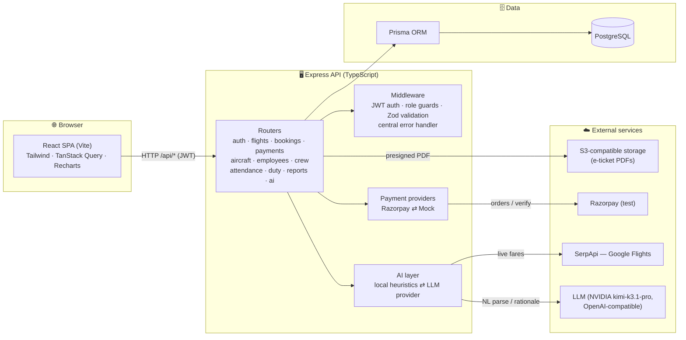
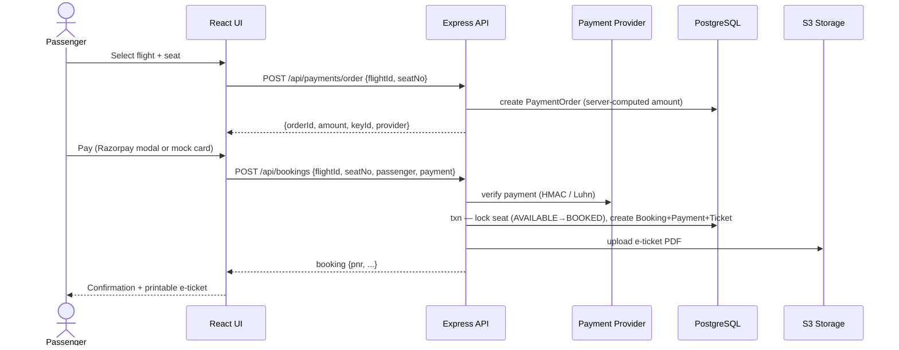
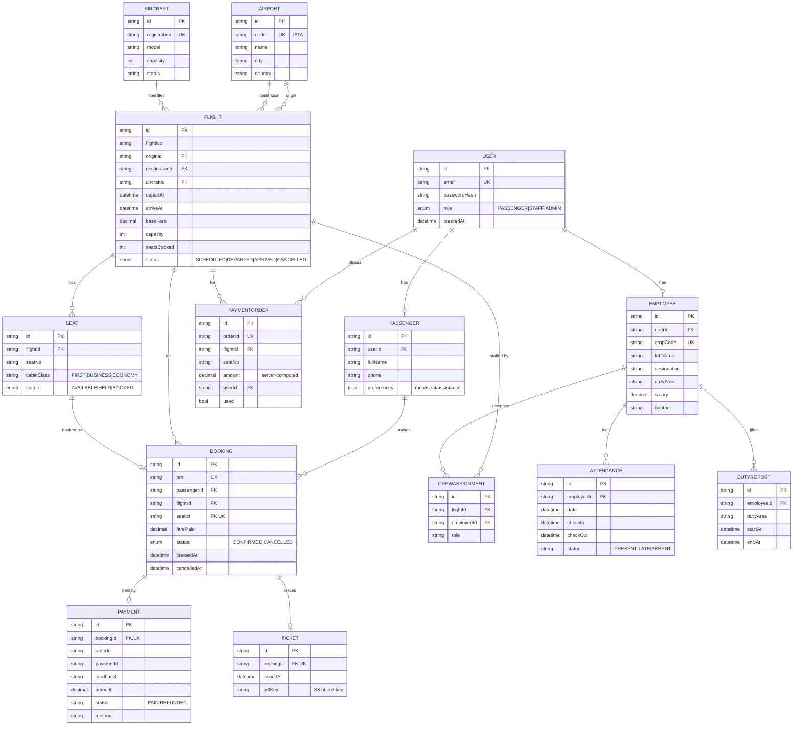

# Horizon Airways ✈️

A full-stack **airline reservation & operations system** — passengers search, book, pay for and manage flights; staff run operations (scheduling, crew, attendance, reporting). Ships with **four AI features** and **real-time flight data**, as a TypeScript monorepo.

**Repo:** https://github.com/nats-crypt/fsad · **Tests:** 103 passing ✅

---

## Table of Contents
1. [Overview](#overview)
2. [Architecture](#architecture)
3. [Monorepo structure](#monorepo-structure)
4. [Tech stack](#tech-stack)
5. [Features](#features)
6. [AI features](#ai-features)
7. [Booking flow](#booking-flow)
8. [Data model (ER diagram)](#data-model)
9. [API reference](#api-reference)
10. [Getting started](#getting-started)
11. [Environment variables](#environment-variables)
12. [Demo data & logins](#demo-data--logins)
13. [Testing](#testing)
14. [NPM scripts](#npm-scripts)

---

## Overview

Horizon Airways has two role-gated modules:

- **Passenger module** — search (classic + natural language), seat selection, payment, e-ticket, cancellation, rebooking.
- **Administration module** — aircraft, employees, flight & crew scheduling, attendance, duty reporting, a demand/crew optimizer, and a full reports dashboard.

Authentication is JWT-based with three roles: `PASSENGER`, `STAFF`, `ADMIN`.

---

## Architecture

The app is a monorepo. In development, Vite serves the UI and proxies `/api` to Express. In the single-process mode, Express serves the built UI **and** the API on one port.



Design principles: a provider abstraction isolates external dependencies (payments, AI, live-flights) so each has a **graceful offline fallback** — the app runs fully even with no external keys.

---

## Monorepo structure

```
fsad/
├─ apps/
│  ├─ api/                     # Express + TypeScript backend
│  │  ├─ src/
│  │  │  ├─ app.ts             # createApp(): wires routers + middleware + static UI
│  │  │  ├─ server.ts          # local entrypoint (loads .env, listens :4000)
│  │  │  ├─ env.ts             # loads repo-root .env for dev
│  │  │  ├─ lib/               # auth, http-error, validate, card (Luhn), pnr, storage (S3), serpapi
│  │  │  ├─ payments/          # provider.ts, razorpay.ts, mock.ts
│  │  │  ├─ ai/                # provider, local, llm, airports, optimizer, fare, rebooking
│  │  │  ├─ routes/            # auth, flights, flights-live, bookings, payments, aircraft,
│  │  │  │                     # employees, crew, attendance, duty, reports, ai-*
│  │  │  └─ __tests__/         # Vitest + Supertest (103 tests)
│  │  └─ vitest.config.ts
│  └─ web/                     # React + TypeScript frontend (Vite)
│     └─ src/
│        ├─ pages/             # Landing, Login, Register, Search, Booking, Confirmation,
│        │                     # MyBookings, admin/*
│        ├─ components/        # SeatMap, FlightCard, LiveFlights, DataTable, CrudModal,
│        │                     # ReportChart, ETicket, FareBadge, RebookingSuggestions, Navbar…
│        └─ lib/               # api client, auth context, utils
├─ packages/
│  └─ db/                      # Prisma schema, client singleton, migrations, seed, demo data
│     └─ prisma/
│        ├─ schema.prisma
│        ├─ seed.ts            # base seed (airports, aircraft, flights, employees, users)
│        └─ enrich.ts          # demo data (daily flights, bookings, attendance, duty)
├─ api/index.ts                # serverless handler (wraps the Express app)
└─ docs/superpowers/           # design spec + implementation plan
```

---

## Tech stack

| Layer | Technologies |
|-------|--------------|
| Frontend | React 18, TypeScript, Vite, Tailwind CSS, React Router, TanStack Query, Recharts, lucide-react, react-to-print |
| Backend | Node 20+, Express 4, TypeScript, Prisma ORM, Zod, JWT (`jsonwebtoken`), bcryptjs |
| Database | PostgreSQL (local Docker for dev; Neon serverless compatible) |
| Storage | S3-compatible object storage (AWS SDK v3) for e-ticket PDFs (`pdfkit`) |
| Payments | Razorpay (test mode) with a mock Luhn-validation gateway fallback |
| Live data | SerpApi Google Flights, with DB fallback |
| AI | OpenAI-compatible LLM (NVIDIA `kimi-k3.1-pro`) with offline heuristic fallback |
| Tests | Vitest + Supertest (103 tests) |

---

## Features

### Passenger
- **Flight search** — classic filters (origin, destination, date, pax) and **natural-language** search
- **Visual seat map** — First / Business / Economy, unavailable seats disabled
- **Payment** — Razorpay test checkout or mock card (16-digit + Luhn + expiry + CVV), server-trusted amounts
- **E-ticket** — boarding-pass style, printable + downloadable, stored in S3 (served via presigned URL)
- **My bookings** — view, cancel (seat released, refund recorded), with AI rebooking suggestions
- **Live Fares** — real-time Google Flights prices; falls back to internal flights automatically

### Admin / Staff
- **Aircraft** & **Employee** CRUD
- **Flight & crew scheduling** (seat maps auto-generated with cabin classes)
- **Attendance** (check-in/out) and **Duty reporting**
- **Demand & Crew Optimizer** (AI)
- **Reports dashboard** — revenue, flights, reservations, cancellations, aircraft, salary, employees, attendance, performance (charts + CSV export)

Security highlights: bcrypt password hashing, JWT with role guards, Zod-validated inputs, **atomic seat locking** (no double-booking), **constant-time** Razorpay signature verification, and **order→amount binding** (prevents payment-amount tampering).

---

## AI features

All AI runs through a provider interface: **offline heuristics by default**, upgrading to the LLM when `LLM_API_KEY` is set (with automatic fallback on error).

| # | Feature | What it does | Endpoint |
|---|---------|--------------|----------|
| 1 | **NL flight search** | "cheap morning flight to Delhi next Friday" → structured query → results | `POST /api/ai/search` |
| 2 | **Demand & crew optimizer** | Predicts load factor; recommends crew/aircraft; flags OVER/UNDER | `GET /api/ai/optimizer` |
| 3 | **Fare forecast** | RISING / STEADY / FALLING + BOOK_NOW / WAIT | `GET /api/ai/fare-forecast/:flightId` |
| 4 | **Smart rebooking** | Ranked same-route alternatives on cancellation | `POST /api/ai/rebooking` |

---

## Booking flow



---

## Data model



**Key constraints:** `Seat(flightId, seatNo)` unique · `CrewAssignment(flightId, employeeId)` unique · `Attendance(employeeId, date)` unique · `Booking.seatId` unique (one booking per seat) · `Booking.pnr` unique.

---

## API reference

All routes are under `/api`. 🔒 = requires auth; 👮 = requires `STAFF`/`ADMIN`.

| Method | Path | Description |
|--------|------|-------------|
| POST | `/auth/register` | Register a passenger → `{token, user}` |
| POST | `/auth/login` | Login → `{token, user}` |
| GET | `/auth/me` 🔒 | Current user |
| POST | `/auth/logout` | Clear session cookie |
| GET | `/flights?origin&destination&date&pax` | Search bookable flights (+ `seatsLeft`) |
| GET | `/flights/:id` | Flight detail incl. seat map |
| POST/PUT/DELETE | `/flights` 👮 | Create/update/delete flights (auto-generates seats) |
| GET | `/flights/live?departureId&arrivalId&outboundDate` | Real-time Google Flights (SerpApi) + DB fallback |
| POST | `/payments/order` 🔒 | Create a payment order (server-computed amount) |
| POST | `/bookings` 🔒 | Book: verify payment → lock seat → ticket + S3 PDF |
| GET | `/bookings/mine` 🔒 | Current user's bookings |
| GET | `/bookings/:id` 🔒 | Booking detail |
| POST | `/bookings/:id/cancel` 🔒 | Cancel (release seat, refund) |
| GET | `/bookings/:id/ticket` 🔒 | E-ticket payload + presigned PDF URL |
| CRUD | `/aircraft`, `/employees` 👮 | Resource management |
| GET/POST/DELETE | `/crew` 👮 | Crew assignments |
| POST/GET | `/attendance/mark`, `/attendance` 👮 | Attendance |
| POST/GET | `/duty`, `/duty/:id/end` 👮 | Duty reporting |
| GET | `/reports/:type?from&to` 👮 | `revenue\|flights\|reservations\|cancellations\|aircraft\|salary\|employees\|attendance\|performance` |
| POST | `/ai/search` | Natural-language flight search |
| GET | `/ai/optimizer` 👮 | Demand & crew optimizer |
| GET | `/ai/fare-forecast/:flightId` | Fare forecast |
| POST | `/ai/rebooking` 🔒 | Smart rebooking suggestions |

---

## Getting started

Prerequisites: **Node 20+**, **Docker** (for local Postgres).

```bash
git clone https://github.com/nats-crypt/fsad && cd fsad
npm install

# 1. Local Postgres
docker run -d --name horizon-pg \
  -e POSTGRES_PASSWORD=postgres -e POSTGRES_DB=horizon -p 5432:5432 postgres:16-alpine

# 2. Env
cp .env.example .env            # fill in keys, or leave blank for fallbacks

# 3. Schema + data
npm run db:generate
npm run db:migrate
npm run db:seed                 # base data
npm run db:demo                 # rich demo data (flights, bookings, attendance, reports)

# 4. Run
npm run dev                     # UI http://localhost:5173 + API http://localhost:4000
# or single process (Express serves built UI + API on :4000):
npm -w @horizon/web run build && (cd apps/api && npm run start)
```

---

## Environment variables

Set in `.env` (gitignored). All are optional — missing keys trigger graceful fallbacks.

| Variable | Purpose |
|----------|---------|
| `DATABASE_URL` | PostgreSQL connection (active DB) |
| `NEON_DATABASE_URL` | Optional cloud Postgres (swap in for deploy) |
| `JWT_SECRET` | JWT signing secret |
| `CLIENT_URL` | Allowed CORS origin (dev: `http://localhost:5173`) |
| `AWS_ENDPOINT_URL_S3`, `AWS_ACCESS_KEY_ID`, `AWS_SECRET_ACCESS_KEY`, `AWS_REGION`, `S3_BUCKET` | E-ticket PDF storage; if unset, PDF upload is skipped |
| `RAZORPAY_KEY_ID`, `RAZORPAY_KEY_SECRET` | Payments; if unset, mock Luhn gateway is used |
| `LLM_API_KEY`, `LLM_BASE_URL`, `LLM_MODEL` | AI via OpenAI-compatible LLM; if unset, offline heuristics |
| `SERPAPI_KEY` | Live Google Flights; if unset, Live Fares falls back to DB |

---

## Demo data & logins

`npm run db:demo` loads **336 flights** (daily on 12 major India routes for 2 weeks), **450+ bookings** (incl. cancellations), **₹27L+ revenue**, **130 attendance records**, crew assignments and duty logs — so every screen and report is populated.

| Role | Email | Password |
|------|-------|----------|
| Admin | `admin@horizon.air` | `Passw0rd!` |
| Passenger | `demo@horizon.air` | `Passw0rd!` |

Reliably-populated routes: DEL↔BOM, DEL↔BLR, DEL↔HYD, DEL↔MAA, DEL→CCU, BOM↔BLR, BOM↔HYD (search a date **tomorrow or later**).

---

## Testing

```bash
npm test          # backend suite (Vitest + Supertest) — requires local Postgres
```

103 tests cover auth, card/Luhn validation, flight search, payment providers, booking (atomic seat lock, order-amount binding), cancellation, reports, S3 fallback, and every AI heuristic — all run offline (no external keys needed).

---

## NPM scripts

| Script | Action |
|--------|--------|
| `npm run dev` | Run API + web concurrently |
| `npm run dev:api` / `npm run dev:web` | Run one side |
| `npm run build` | Build web (and generate Prisma client) |
| `npm test` | Backend test suite |
| `npm run db:generate` | Generate Prisma client |
| `npm run db:migrate` | Apply migrations |
| `npm run db:seed` | Base seed |
| `npm run db:demo` | Rich demo data |

---

*Built spec-first: see `docs/superpowers/` for the design document and the task-by-task implementation plan.*
